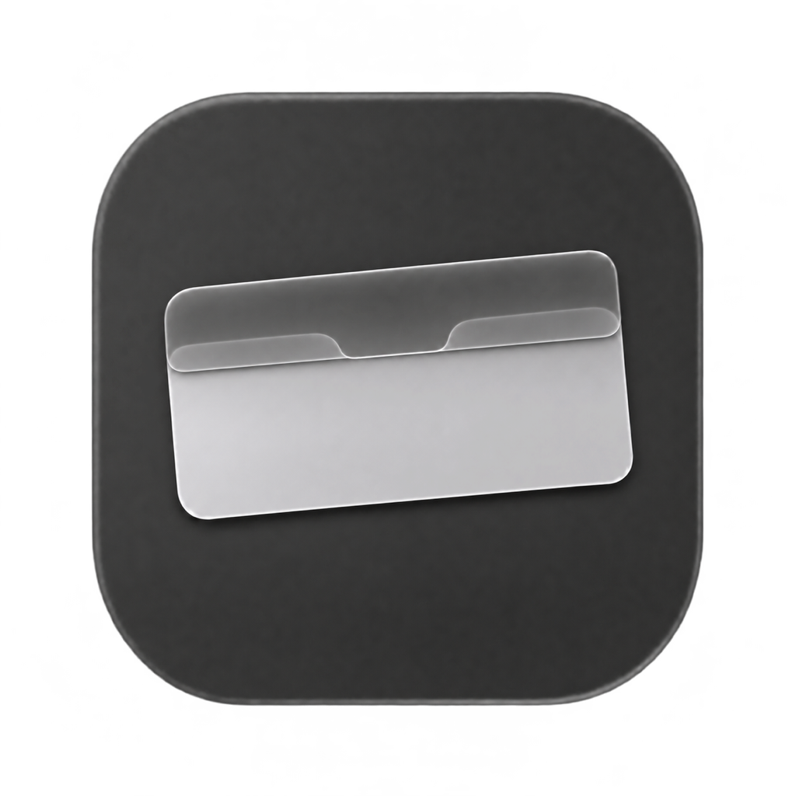

  

<h1 align="center">NotchVeil</h1>

<strong>배경화면을 바꾸지 않고 맥북 노치를 가립니다.</strong>

  <a href="https://github.com/HoWon037/NotchVeil/releases/download/v0.4.1/NotchVeil.dmg"><strong>Mac용 다운로드 (.dmg)</strong></a> 
  Apple Silicon · macOS 12 이상 · <a href="README.md">English</a>

## 빠른 시작

1. `NotchVeil.dmg`를 열고 앱을 **응용 프로그램** 폴더에 끌어다 놓습니다.
2. 응용 프로그램 폴더에서 **NotchVeil**을 엽니다. 처음 실행하면 노치 가리기가 켜져 있습니다.

## 동작 방식

메뉴 막대 뒤에 검은 배경을 띄워 노치를 가립니다. 맥북 모델마다 크기를 정해 두는 대신, macOS가 알려주는 화면의 안전 영역에 맞춰 배경 높이를 정합니다.

검은 배경은 다른 앱 창 뒤에 놓여 클릭을 가로채지 않습니다. 배경화면이나 노치가 없는 화면은 그대로 둡니다. 잠금화면에서는 노치가 보입니다.

## 설정

설정 창을 닫아도 NotchVeil은 계속 동작합니다. 설정을 바꾸려면 응용 프로그램에서 앱을 다시 여세요. 메뉴 막대 아이콘을 켜 둔 경우에는 **설정 열기…**를 눌러도 됩니다.

| 설정 | 동작 |
| --- | --- |
| **노치 가리기** | 앱은 켜 둔 채 검은 배경만 켜거나 끕니다. |
| **로그인할 때 자동 실행** | 로그인하면 설정 창을 띄우지 않고 시작합니다. macOS 13 이상에서 쓸 수 있습니다. |
| **메뉴 막대 아이콘 표시** | 메뉴 막대에서 설정을 열거나 노치 가리기를 켜고 끌 수 있습니다. |
| **언어** | 시스템 설정을 따르거나 한국어와 영어 중에서 고릅니다. |

앱을 끄려면 설정 창에서 **앱 종료**를 누르세요.

---

[릴리스](https://github.com/HoWon037/NotchVeil/releases) · [소스 빌드](docs/development.md) · [기여 안내](CONTRIBUTING.md) · [MIT 라이선스](LICENSE)
