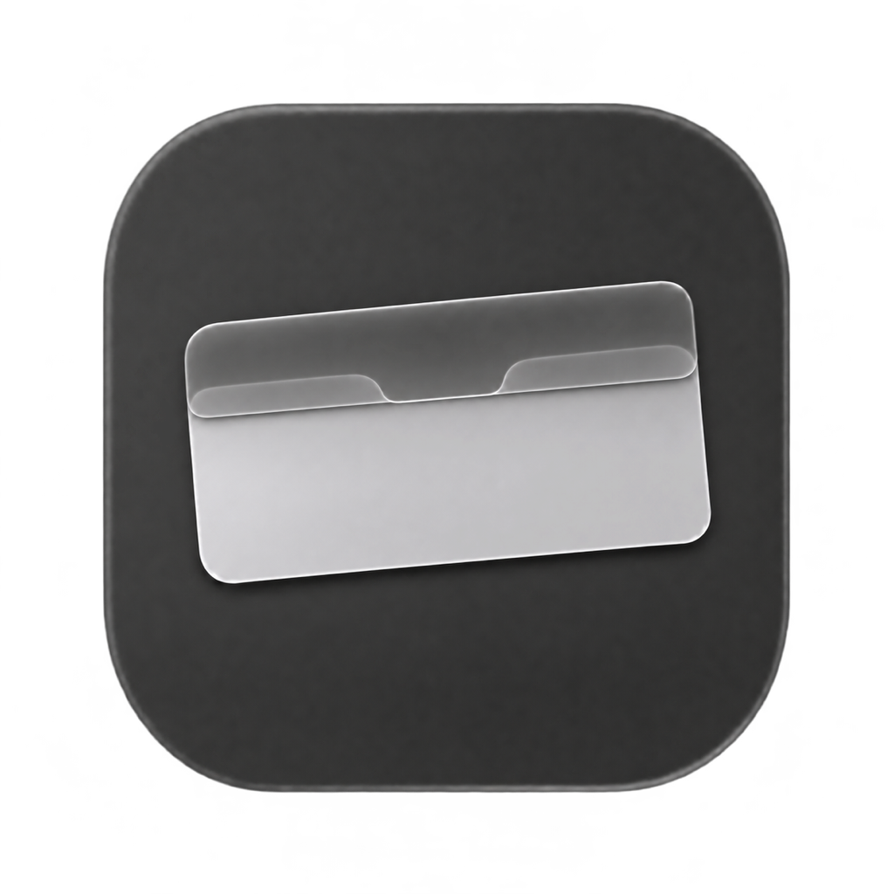

  

<h1 align="center">NotchVeil</h1>

<strong>Hide the MacBook notch without changing your wallpaper.</strong>

  <a href="https://github.com/HoWon037/NotchVeil/releases/download/v0.4.1/NotchVeil.dmg"><strong>Download for Mac (.dmg)</strong></a> 
  Apple Silicon · macOS 12+ · <a href="README.ko.md">한국어</a>

## Install

Open `NotchVeil.dmg` and drag the app into **Applications**.

## Features

NotchVeil adds a black background behind the menu bar on displays with a notch. Its height comes from macOS display information, not a list of MacBook models. The background stays behind other windows and doesn’t intercept clicks.

NotchVeil supports an optional menu bar icon, launch at login on macOS 13 or later, and English and Korean. It doesn’t hide the notch on the lock screen.

---

[Releases](https://github.com/HoWon037/NotchVeil/releases) · [Build from source](docs/development.md) · [Contributing](CONTRIBUTING.md) · [MIT License](LICENSE)
